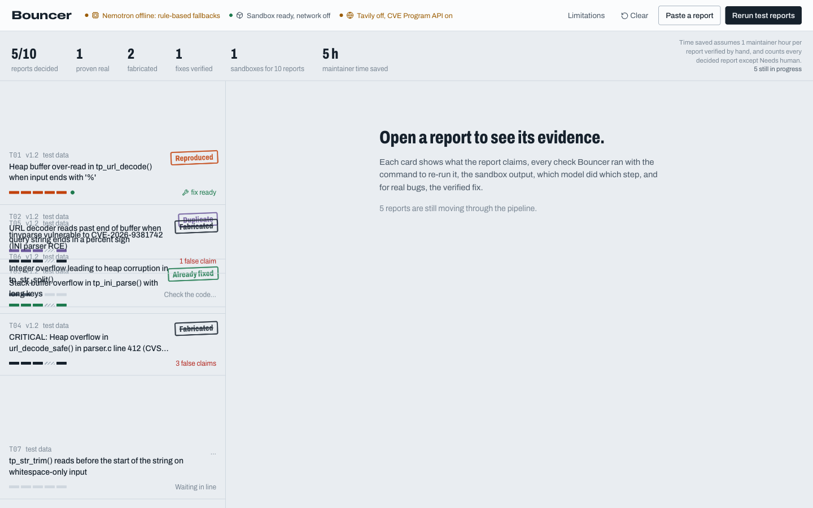
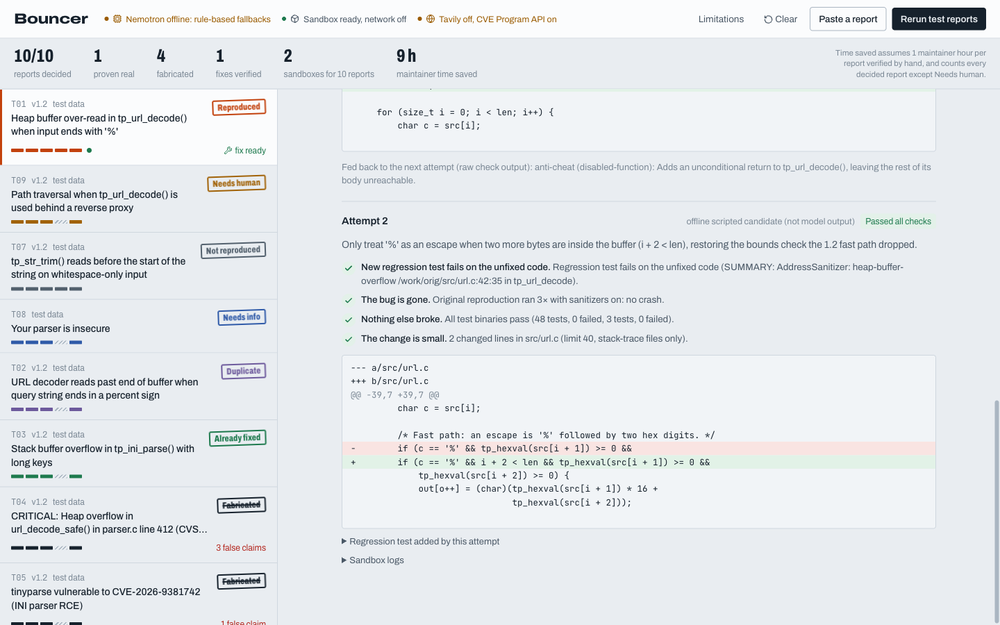

# Bouncer

**Bouncer filters the fake bug reports, proves the real ones, and drafts the fix, so an open-source maintainer goes from "report received" to "patch ready to review" without the grunt work.**



Track: **Coding and Agentic Engineering**. Built with **NVIDIA Nemotron 3 (Nano, Super, Ultra) on Nebius Token Factory**, a network-less Docker sandbox, the CVE Program API and Tavily.

> **Core rule:** every verdict rests on something Bouncer checked or ran, never on an AI opinion. It never auto-closes a report and never auto-merges a fix.

## The problem

Writing a convincing fake security report now takes seconds. Disproving it still takes a volunteer maintainer an hour: check out the version, grep for the function, look up the CVE, run the PoC, and write a polite reply. In 2026 this broke intake at real projects:

- **curl** stopped reading security reports for five weeks; the share of real reports had fallen from about 15% to under 5% (reported by Pinggy; sources listed in the project plan).
- **HackerOne's Internet Bug Bounty** paused new submissions; fixing, not finding, had become the bottleneck.
- **Godot** maintainers called the wave of AI-generated pull requests "draining and demoralizing"; GitHub added a switch to disable PRs entirely.

The bottleneck is *verification*. Bouncer automates it.

## How it works

Every report passes through five stages. Cheap checks run first, so a fabricated report is stamped before any sandbox starts.

| # | Stage | What actually happens |
|---|---|---|
| 1 | **Extract claims** | Nemotron 3 Nano turns the free text into JSON: version, files, functions, line numbers, quoted code, CVE IDs, commands, bug class, environment needs. Regex extraction runs too. **Anything the model extracts that does not appear word for word in the report is discarded.** |
| 2 | **Ground in the code** | `git grep` at the claimed tag, at every tag, and across history; whitespace-insensitive *exact* match of quoted code (a changed `>` vs `>=` is a different program); line-in-function; `git log -S` + `git tag --contains` to find the release that already fixed it. |
| 3 | **Check the outside world** | Every CVE ID is looked up in the **CVE Program API** (`cveawg.mitre.org`), which answers authoritatively whether the ID was ever issued. Tavily web search adds context (optional). Duplicate detection runs against earlier reports. |
| 4 | **Reproduce in a sandbox** | A fresh container (`--network none`, read-only root, uid 10001, `cap-drop ALL`, `no-new-privileges`, memory/CPU/pids limits, timeout, **no secrets**) builds the claimed version with **AddressSanitizer + UBSan** and runs the reporter's own steps **3 times**. |
| 5 | **Decide and explain** | **Code rules** pick the verdict from the evidence. Nemotron (Nano for clear cases, Ultra for judgement calls) writes the explanation and a polite reply to the reporter. |

**Verdicts** (queue order): Reproduced → Needs human → Not reproduced → Needs info → Duplicate → Already fixed → Fabricated. "Fabricated" requires at least one *hard, checkable falsehood*. When the evidence is mixed (a false detail plus a runnable PoC), the sandbox runs, and anything short of a matching crash becomes **Needs human, never Fabricated**.

### The patch loop (Reproduced reports only)

1. **Root cause:** Nemotron 3 Ultra reads the sanitizer report and the code.
2. **Patch:** Nemotron 3 Super proposes minimal search/replace edits plus a regression test.
3. **Anti-cheat scan** rejects: disabling the function, catch-all error hiding, touching sanitizer/build/test config, editing existing tests, special-casing the exact repro input.
4. **Three checks in a fresh sandbox:** the bug is gone (3 runs, sanitizers on); nothing else broke (the full test suite passes); the change is small (≤ 40 lines, stack-trace files only). On top of that, **the new regression test must fail on the unfixed code**.
5. **Feedback:** Nemotron 3 Nano summarises the failure, then back to step 2, up to 5 attempts. Otherwise the result is an honest "could not fix safely" with the root cause attached.

A verified fix goes into a **draft private GitHub security advisory with a temporary private fork**, never a public pull request.



Architecture diagram and component details: [docs/ARCHITECTURE.md](docs/ARCHITECTURE.md).

## How Bouncer uses NVIDIA Nemotron and Nebius

All model calls go through one gateway ([`backend/bouncer/gateway.py`](backend/bouncer/gateway.py)) to **Nebius Token Factory** (`https://api.tokenfactory.nebius.com/v1/`, OpenAI-compatible). No other model provider is used.

| Step | Model | Why this one |
|---|---|---|
| Extract claims from the report into JSON | **Nemotron 3 Nano** | Runs on every report; must be fast and cheap |
| Compare with an earlier report (borderline duplicates) | Nemotron 3 Nano | High volume, simple judgement |
| Summarise failed patch attempts | Nemotron 3 Nano | High volume, simple task |
| Turn prose steps into a reproduction script | **Nemotron 3 Super** | Everyday coding work |
| Write the patch and the regression test | Nemotron 3 Super | Coding work, retried in a loop |
| Root-cause analysis from crash log and code | **Nemotron 3 Ultra** | Needs serious reasoning across code and logs |
| Explain Reproduced / Not reproduced / Needs human verdicts | Nemotron 3 Ultra | Judgement calls; must be careful and clear |

Every call is schema-validated JSON (rejected and retried if malformed). It is logged with model ID, tokens, latency and cost, and shown in each card's **Models** tab. A daily budget cap stops calls once reached. Model IDs default to the Token Factory catalogue names and can be overridden by env. `make check-models` lists what your key can see and makes one test call per tier.

**What runs where, honestly:** Nemotron runs on Nebius-hosted infrastructure; nothing in this repo claims local GPU acceleration. The sandbox runs on **local Docker** (verified). For hosting, the plan's documented fallback applies: Docker with `--network none` on a Nebius VM. That is because the Nebius Serverless Jobs CLI reference lists no network-off option.

## Quick start

Requirements: Python 3.11+, Node 20+, Docker (colima or Docker Desktop; the repo must be under a folder Docker can mount, e.g. your home directory).

```bash
git clone <this repo> bouncer && cd bouncer
cp .env.example .env          # add NEBIUS_API_KEY (and optionally TAVILY_API_KEY)
make setup                    # venv + deps, npm ci, sandbox image, demo repo
make api                      # terminal 1: API on http://127.0.0.1:8000
make web                      # terminal 2: dashboard on http://localhost:3000
```

Open http://localhost:3000 and click **Run 10 test reports**, or **Paste a report** to try your own against the demo project.

Without `NEBIUS_API_KEY`, everything still runs. Each model step uses a deterministic fallback (regex extraction, template explanations, and two pre-written patch candidates for the demo bug), and the UI labels each one **"offline rules" / "not model output"**. Verdicts are identical either way, because they are computed by rules from git, CVE and sandbox evidence.

### Environment variables

| Variable | Required | Purpose |
|---|---|---|
| `NEBIUS_API_KEY` | for Nemotron | Token Factory key |
| `NEBIUS_BASE_URL` | no | Defaults to `https://api.tokenfactory.nebius.com/v1/` |
| `NEMOTRON_{NANO,SUPER,ULTRA}_MODEL` | no | Override model IDs |
| `TAVILY_API_KEY` | no | Web search for CVEs and advisories |
| `GITHUB_TOKEN`, `GITHUB_REPO` | no | Only to actually create a draft advisory on a real repo |
| `BOUNCER_DAILY_BUDGET_USD` | no | Model spend cap (default 5) |
| `BOUNCER_SANDBOX_TIMEOUT` | no | Seconds per sandbox run (default 120) |
| `NEXT_PUBLIC_API_URL` | no | Dashboard → API URL (default `http://localhost:8000`) |

## Testing

```bash
make test     # backend: 28 pytest tests (unit + API + 10-report end-to-end with the real sandbox); frontend: eslint + tsc
make demo     # prints the 10 test reports with expected vs actual verdicts
```

The end-to-end test asserts all 10 expected verdicts and the queue order. It also checks that fabricated reports never start a sandbox, that the patch loop rejects the cheating attempt and passes the real fix with all checks green, that the advisory is drafted and not sent, and that the reproduced-bug reply leaks no details. The gateway's live path is tested against a fake OpenAI-compatible client: malformed output is retried, hallucinated claims are dropped, and cost is logged.

## Demo data

[`demo/tinyparse`](demo/tinyparse) is a **fictional** MIT-licensed C library (URL decoder, INI parser, string helpers, a CLI and a 48-test suite; about 970 lines in total). It is built into a real git repo with tags v1.0, v1.1 and v1.2 by [`demo/build_tinyparse.py`](demo/build_tinyparse.py). It contains two planted bugs:

- **Bug A (v1.2):** `tp_url_decode()` reads one byte past the input buffer on a trailing `%`. The 1.2 "fast path" dropped the bounds check.
- **Bug B (v1.0, fixed in v1.1):** `tp_ini_parse()` writes the key terminator one byte past a 32-byte stack buffer.

[`demo/reports/reports.json`](demo/reports/reports.json) holds 10 clearly labelled test reports: a real overflow, a duplicate, an already-fixed bug, three fabrications (non-existent function, never-issued CVE, invented code), a plausible non-crash, a vague "your parser is insecure", a needs-a-live-server report, and a prompt-injection attempt.

## Running it on your own repository

Today the claim checker (stages 1–3) works on any git repository. Point `data/repos/<name>` at a clone and change `PROJECT` in `backend/bouncer/pipeline.py`. Sandbox reproduction assumes a `make SAN=1` build. Generalising the build recipe per project (a small `bouncer.toml`) and GitHub App intake are the next steps.

## Safety design

- Untrusted code runs only in throwaway, network-less, read-only, non-root, capability-free containers with resource limits and **no secrets**.
- Bouncer runs only the reproduction the reporter supplied. It never searches for new vulnerabilities or writes exploits.
- Report text is wrapped as untrusted data in every prompt. Hidden text (HTML comments, zero-width characters, "ignore previous instructions") is flagged on the card. The verdict is computed by code, so the text cannot steer it.
- Security fixes go to a private draft advisory. Replies about reproduced bugs say only "under review". Nothing is sent or published without an explicit maintainer click.

## Limitations

- **Languages:** the first version supports C (built with sanitizers) and pure Python projects. Other languages fall back to claim checking only, with no reproduction. *(This build: the Python path is claim checking only.)*
- **Complex setups:** bugs that need a live server, special hardware, a particular OS or a large dataset cannot be reproduced in the sandbox. They get Needs human, never Fabricated.
- **Not reproduced is not "false":** some real bugs only trigger rarely or under timing conditions. Bouncer says what it tried, and does not call the report fake.
- **Fix quality:** a patch that passes all three checks can still be wrong in ways the tests do not cover. It is a draft for review, never a merge.
- **Logic and design flaws:** vulnerabilities with no crash (for example, an authorization mistake) are hard to verify automatically. Bouncer can ground the claims, but not prove them.
- **Duplicate detection** relies on search and the model's comparison, and can miss rewritten duplicates.
- **Cost:** every reproduction uses paid CPU compute on Nebius. The hosted demo has a daily cap.
- **Evaluation size:** results in the demo come from 10 designed reports and a small set of public examples, not a large benchmark.
- **This build specifically:** live Nemotron output was not verified in the build environment (no Token Factory key was available); the sandbox runs on local Docker rather than Nebius; the dashboard is not deployed; the advisory publisher was not exercised against GitHub.

## Repository map

```
backend/bouncer/   API, orchestrator, stages, gateway, sandbox, patch loop, advisory
backend/tests/     pytest suite + run_demo.py
frontend/          Next.js 16 dashboard (Tailwind 4)
sandbox/           Dockerfile for the sanitizer sandbox
demo/              fictional tinyparse sources, repo builder, 10 test reports
docs/              requirements analysis, strategy, architecture, plan, state, feedback log
submission/        demo script, video storyboard, Devpost text, screenshots
```

## Licence

MIT. See [LICENSE](LICENSE). `tinyparse` is fictional test data, also MIT.
