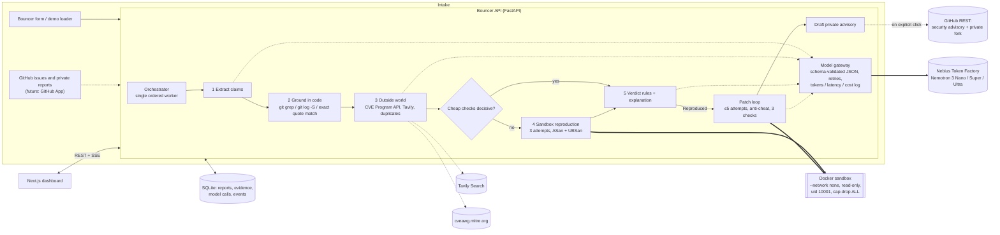

# Architecture

Bouncer is a web dashboard, an API that runs the pipeline, and short-lived sandboxes that build and run untrusted code. Every model call goes through one gateway to Nebius Token Factory.

## Components

| Component | File(s) | Responsibility |
|---|---|---|
| API | `backend/bouncer/api.py` | REST + Server-Sent Events, validation, rate limit, CORS (localhost only) |
| Orchestrator | `pipeline.py` | Runs the five stages in arrival order, emits events, hands Reproduced reports to the patch worker |
| Claim extractor | `extract.py` | Regex extraction on every report, plus Nemotron 3 Nano. Model output is filtered to claims that appear verbatim in the report |
| Claim checker | `grounding.py` | git: files/functions at the claimed tag, at any tag, anywhere in history; whitespace-insensitive exact quote matching; line-in-function; `git log -S` + `git tag --contains` for "already fixed" |
| Outside world | `outside.py` | CVE existence via the CVE Program API (authoritative), Tavily web search, duplicate scoring against earlier reports (+ Nano for borderline cases) |
| Sandbox | `sandbox.py`, `repro.py`, `sandbox/Dockerfile` | One container per job: `--network none`, read-only root, tmpfs work dir, uid 10001, `--cap-drop ALL`, `no-new-privileges`, 768 MB, 1.5 CPU, 256 pids, wall-clock timeout, no env passed in |
| Verdict engine | `verdict.py` | Pure functions over the evidence. Order of rules documented in the module |
| Explainer | `explain.py` | Nano (clear-cut) or Ultra (judgement calls) write the summary and reporter reply. Reproduced replies are a fixed template |
| Patch module | `patcher.py`, `anticheat.py` | Ultra root cause → Super search/replace edits + regression test → anti-cheat → sandbox checks (regression test fails on old code, crash gone ×3, full suite passes, ≤40 changed lines in stack-trace files) → Nano failure summary → retry |
| Advisory | `advisory.py` | Builds the GitHub "create repository security advisory" payload + private-fork steps. Sends only on explicit click with a token |
| Model gateway | `gateway.py` | OpenAI-compatible client → Token Factory; JSON mode with fallback; pydantic validation and corrective retries; logs every call; daily budget cap |
| Dashboard | `frontend/src` | Queue (sorted, FLIP animated), case file with Evidence / Sandbox / Fix / Advisory / Reply / Models / Original tabs |

## Data flow

A report enters through `POST /api/reports` (or the demo loader) and is stored with status `queued`. The worker extracts and grounds its claims, then queries the outside world. A rule check decides whether cheap evidence is decisive. Fabricated, duplicate, already-fixed and needs-info reports never start a sandbox. Otherwise a job directory (a `git archive` of the claimed tag, the attachments and the repro script) is mounted read-only into a fresh container, which builds with `make SAN=1` and runs the script three times. The verdict rules run, the explanation is written, and an SSE event updates every open dashboard. Reproduced reports go to the patch worker, which writes a `patch` and an `advisory` draft.

## API boundaries

| Method | Path | Purpose |
|---|---|---|
| GET | `/api/health` | Model mode, sandbox status, Tavily/GitHub availability, budget |
| GET | `/api/reports` | Sorted queue cards + stats |
| GET | `/api/reports/{id}` | Full evidence, patch, advisory, model calls, events |
| POST | `/api/reports` | Submit a report (title ≤200, body ≤20k, ≤3 attachments ≤64 KB, safe names) |
| POST | `/api/reports/{id}/decision` | Maintainer accept / reject / escalate / reopen |
| POST | `/api/reports/{id}/advisory/publish` | Create the draft advisory on GitHub (requires token + repo) |
| POST | `/api/demo/load`, `/api/demo/reset` | Load the 10 labelled test reports / clear |
| GET | `/api/repo/file?ref&path` | Read a file at a release tag (validated) |
| GET | `/api/events` | SSE stream of pipeline events |

## Authentication model

The demo runs locally and has no user accounts. The API binds to 127.0.0.1 and CORS allows only localhost origins. A hosted deployment should put the dashboard and API behind an auth proxy (or GitHub OAuth for maintainers) and keep the public submission form rate-limited. Secrets (`NEBIUS_API_KEY`, `TAVILY_API_KEY`, `GITHUB_TOKEN`) live only in the API process environment and are never passed into sandboxes.

## Model integration

`Gateway.json()` is the only path to a model. It sends `response_format: json_object` (retrying without it if the deployment rejects it), strips `<think>` blocks, validates against a pydantic schema, and feeds validation errors back for up to three attempts. Each call is logged with model ID, tokens, latency and cost (Token Factory list prices, overridable via env). Report text is always wrapped in `<untrusted_report>` tags with an explicit instruction to treat it as data. Zero-width and bidi characters are stripped, and tag break-outs are neutralised.

## Storage

SQLite (`data/bouncer.sqlite3`) holds reports, JSON evidence, model calls and events. Sandbox job directories (inputs, scripts, raw output logs) live in `data/runs/<run_id>/` for auditability. The plan's production target is Postgres + object storage; `db.py` is the only module that would change.

## Deployment architecture

- **Local (verified):** `make setup && make api && make web`, Docker via colima or Docker Desktop.
- **Hosted (documented, not deployed):** the dashboard on Vercel (static Next.js; set `NEXT_PUBLIC_API_URL`). The API and sandbox go on a Nebius VM with Docker (the plan's documented fallback), because sandboxes need `--network none`, and the Nebius Serverless Jobs CLI reference lists no network-off flag and has a 1 h minimum timeout. The same image (`sandbox/Dockerfile`) and job script would run unchanged as a Serverless Job if network isolation becomes available there.
